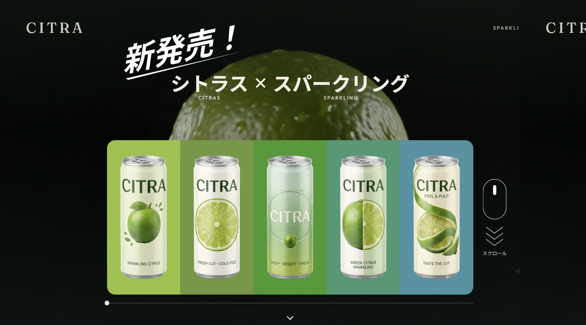
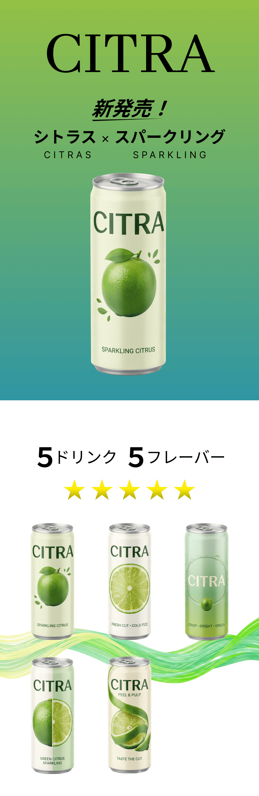

# CITRA

【デモ】
- Site：https://citra.see-u-soon.design/
- デスクトップ / モバイル

<table>
  <tr>
    <td width="70%" valign="top">
      
    </td>
    <td width="30%" valign="top">
      
    </td>
  </tr>
</table>

架空ドリンクブランドのデモ用ランディングページです。
本番販売・実在企業のサイトではありません。

## プロジェクトの概要

【HERO の scroll scrub を体験する】
- スクロール量に動画再生位置を同期し、操作そのものが演出になる構成にする。

【架空ブランドの LP として見せる】
- 生成動画と 5 フレーバーの缶を一つのページで伝える。

## セクションと主な機能

【HERO（モバイル）】
- md 未満は静的な缶＋グラデーション。動画 scrub は置かない。

【HERO（デスクトップ）】
- citrus 生成動画をスクロール量に scrub する。
- 続けて 5 製品のストーリー（カード切替）をスクロールで進める。

【Introduction】
- 「5 ドリンク / 5 フレーバー」と、缶の並びを視差で見せる。

【CITRAとは】
- ブランド説明と製品イメージを、反対方向の視差で見せる。

【FOOTER】
- ブランド名・コピー・著作表示。お問い合わせ送信は置かない。

## 技術スタック

【デザイン】
- Figma Pro（Full Seat）

【コーディング エージェント】
- Cursor Pro

【フレームワーク】
- Next.js 16.3（App Router）。

【言語】
- TypeScript 5。
  ※コンポーネントの props を型で揃えるため。

【UI】
- React 19.2 / Tailwind CSS 4。

【アニメーション】
- 自前の scroll scrub（動画 `currentTime` 同期）と parallax。
  ※GSAP は使わず、HERO と紹介セクションのスクロール演出に絞るため。

## 設計上の工夫

【情報の選別】
- 認証・課金・問い合わせ送信は置かず、HERO 体験とブランド紹介に絞る。

【レスポンシブ】
- モバイルは静的 HERO、デスクトップは scrub＋製品ストーリー。端末ごとに体験を分ける。

【メディア】
- scrub 用に all-intra の mp4 を用意し、スクロール追従のシークを安定させる。

## 品質確認

【品質管理】
- `npm run lint` のエラー：0件
- `npm run typecheck` のエラー：0件
- Viewtest：完了
- Playwright：完了
- local 上での目視・動作確認：完了
- Deploy 後の目視・動作確認：完了
- Lighthouse Desktop Performance：96
- Lighthouse Mobile Performance：90
- Accessibility：98
- Best Practices：100
- SEO：対象外

【Microsoft Edge (Latest)】
- デスクトップ：1440 × 800：完了
- タブレット：768 × 1024：完了

【Google Chrome (Latest)】
- デスクトップ：1440 × 800：完了
- タブレット：768 × 1024：完了

【Safari（iOS・Latest）】
- モバイル：390 × 844：完了

## 作者

【名前】
- Takashi Ogawa

【開発期間】
- 実働 約 1 か月

【その他】
- ポートフォリオ: https://portfolio.see-u-soon.design
- GitHub: https://github.com/onion4989
- CITRA：https://citra.see-u-soon.design/
